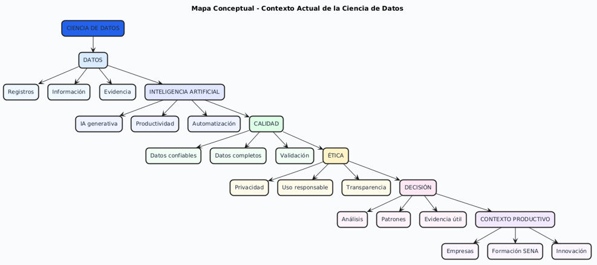
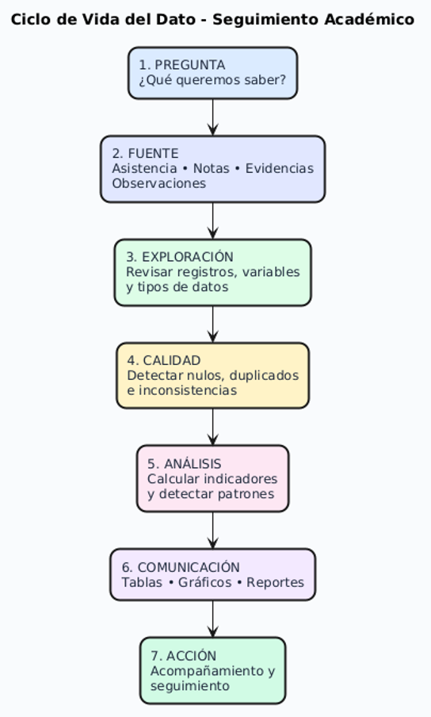
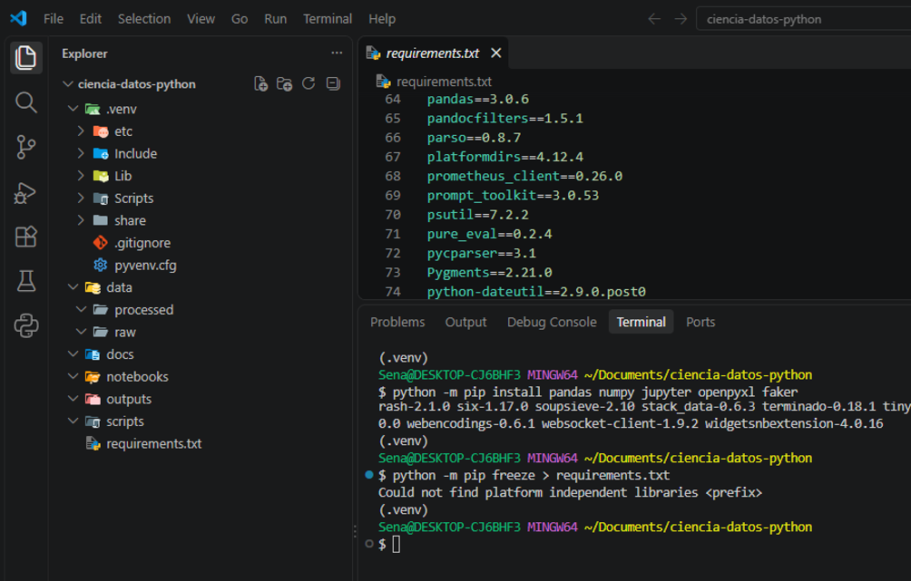
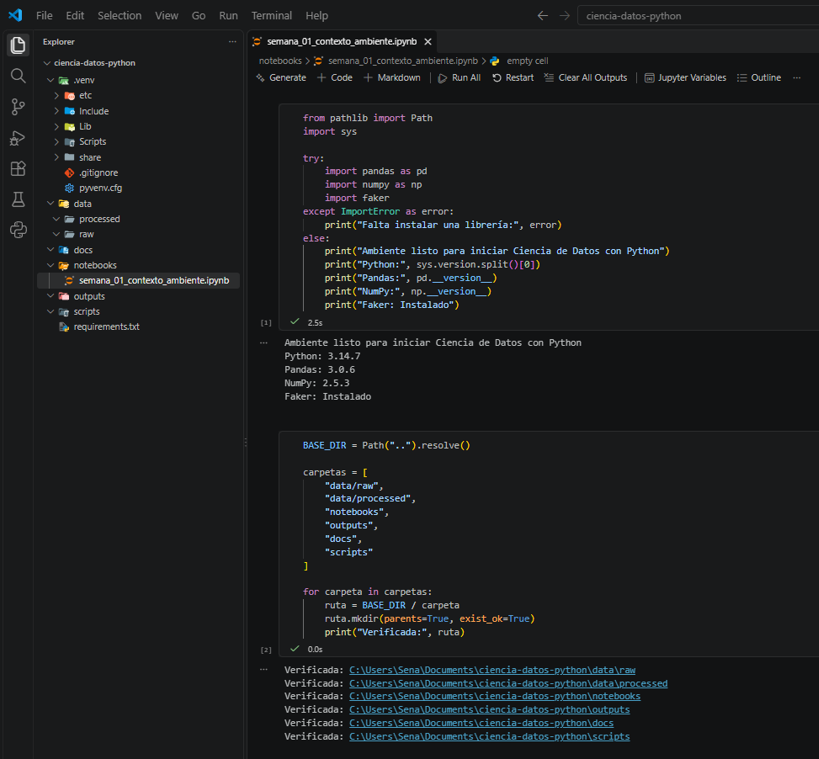

# 🐍 Ciencia de Datos con Python — Semana 1

<p align="center">


</p>

> **Proyecto académico — Ciencia de Datos con Python**

---

## 📌 Propósito

Preparar un **ambiente de trabajo reproducible** y comprender el valor de los datos como herramienta fundamental para el análisis y la toma de decisiones.

---

## 📖 Descripción

Este proyecto contiene las actividades desarrolladas durante la **Semana 1 de Ciencia de Datos con Python**, correspondiente al programa de **Análisis y Desarrollo de Software (ADSO)** del SENA.

Durante esta semana se abordaron conceptos fundamentales relacionados con:

- 📊 Datos, información y conocimiento.
- 🎯 Toma de decisiones basada en datos.
- 🧠 Inteligencia artificial.
- 🔄 Ciclo de vida de los datos.
- ✅ Calidad de los datos.
- 🔐 Ética y privacidad.
- 🛡️ Protección de información personal.
- 🐍 Configuración de un ambiente de trabajo con Python.

---

# 📁 Estructura del proyecto

```text
ciencia-datos-python/
│
├── data/
│   ├── raw/
│   └── processed/
│
├── notebooks/
│   └── semana_01_contexto_ambiente.ipynb
│
├── outputs/
│
├── docs/
│   └── img/
│       ├── mapa_conceptual.png
│       ├── ciclo_vida_dato.png
│       ├── estructura_proyecto.png
│       └── verificacion_notebook.png
│
├── scripts/
│
├── .venv/
│
├── .gitignore
├── README.md
└── requirements.txt
```

### 📂 Descripción de las carpetas

| Carpeta / Archivo | Descripción |
|---|---|
| `data/raw/` | Contiene los datos originales sin modificaciones. |
| `data/processed/` | Contiene los datos transformados o procesados. |
| `notebooks/` | Contiene los notebooks utilizados durante el análisis. |
| `outputs/` | Almacena reportes, resultados y archivos generados. |
| `docs/` | Contiene documentación complementaria del proyecto. |
| `docs/img/` | Contiene las imágenes utilizadas como evidencias. |
| `scripts/` | Contiene scripts y código reutilizable. |
| `.venv/` | Entorno virtual de Python utilizado para el proyecto. |
| `.gitignore` | Define los archivos y carpetas que Git debe ignorar. |
| `requirements.txt` | Lista las dependencias necesarias para ejecutar el proyecto. |
| `README.md` | Documentación principal del proyecto. |

> **Nota:** La carpeta `.venv/` es un entorno local y no debe subirse al repositorio de GitHub.

---

# 🛠️ Tecnologías utilizadas

| Tecnología | Uso |
|---|---|
| 🐍 **Python 3.14** | Lenguaje principal del proyecto. |
| 🐼 **Pandas** | Manipulación y análisis de datos. |
| 🔢 **NumPy** | Operaciones numéricas y manejo de arreglos. |
| 📓 **Jupyter Notebook** | Desarrollo y documentación interactiva. |
| 📗 **OpenPyXL** | Lectura y escritura de archivos Excel. |
| 🎲 **Faker** | Generación de datos ficticios para pruebas. |
| 💻 **Visual Studio Code** | Editor de código utilizado durante el desarrollo. |
| 🔧 **Git / GitHub** | Control de versiones y almacenamiento del proyecto. |
| 📐 **PlantUML** | Creación de diagramas y representaciones visuales. |

---

# ⚙️ Ambiente reproducible

Para trabajar correctamente con el proyecto se utiliza un entorno virtual de Python.

## 1. Crear el entorno virtual

Desde la carpeta principal del proyecto:

```bash
python -m venv .venv
```

## 2. Activar el entorno virtual

En **Git Bash**:

```bash
source .venv/Scripts/activate
```

Si la activación fue correcta, aparecerá algo similar a:

```text
(.venv) Sena@DESKTOP-XXXX MINGW64 ~/Documents/ciencia-datos-python
$
```

## 3. Actualizar pip

```bash
python -m pip install --upgrade pip
```

## 4. Instalar las dependencias

```bash
python -m pip install -r requirements.txt
```

---

# 🔍 Verificación del entorno

El notebook principal del proyecto es:

```text
notebooks/semana_01_contexto_ambiente.ipynb
```

Este notebook permite comprobar que el ambiente de trabajo se encuentra correctamente configurado.

### Se verifica:

- ✅ Versión de Python.
- ✅ Instalación de Pandas.
- ✅ Instalación de NumPy.
- ✅ Instalación de Faker.
- ✅ Instalación de OpenPyXL.
- ✅ Funcionamiento de Jupyter.
- ✅ Estructura de carpetas del proyecto.

---

# 📊 Flujo básico de trabajo

El proyecto sigue una estructura organizada para trabajar con datos:

```text
Datos originales
      │
      ▼
  data/raw/
      │
      ▼
Procesamiento y limpieza
      │
      ▼
data/processed/
      │
      ▼
   Análisis
      │
      ▼
   Outputs
      │
      ▼
Resultados y conclusiones
```

Esta organización permite conservar los datos originales y mantener separado el proceso de transformación y análisis.

---

# 📚 Evidencias de aprendizaje

## 1. Reflexión inicial: del dato a la decisión

Durante la actividad se analizó cómo un dato puede transformarse en información, conocimiento y finalmente en una decisión orientada a mejorar un proceso.

| Situación | Dato | Información | Conocimiento | Decisión posible |
|---|---|---|---|---|
| Asistencia | 72% | El aprendiz ha asistido al 72% de las sesiones | Una asistencia inferior a la esperada puede afectar el proceso formativo | Realizar seguimiento y acompañamiento |
| Actividades | 6 de 10 | Se ha entregado el 60% | Existe un nivel de cumplimiento bajo | Establecer un plan para ponerse al día |
| Rendimiento | 3.2 / 5.0 | Promedio de 3.2 | Existen oportunidades de mejora | Identificar temas con mayor dificultad |

---

# 🧠 2. Diagnóstico de saberes previos

Se realizó un diagnóstico relacionado con los conceptos fundamentales de Ciencia de Datos.

Entre los temas abordados se encuentran:

- Concepto de dato e información.
- Datos en ambientes de formación.
- Archivos CSV.
- Filas y columnas.
- Tipos de datos.
- Datos personales.
- Datos incompletos y duplicados.
- Herramientas para trabajar con datos.
- Expectativas frente al aprendizaje de Ciencia de Datos con Python.

### Autoevaluación

| Área | Nivel (1–4) |
|---|:---:|
| Python | 3 |
| Excel / CSV | 3 |
| Lectura de tablas | 3 |
| Interpretación de gráficos | 2 |
| Ética de datos | 3 |
| Organización de archivos | 3 |

### Reflexión

El nivel inicial es principalmente básico e intermedio. Se cuenta con conocimientos previos de programación y manejo de información, pero es necesario fortalecer los conocimientos relacionados con el análisis de datos, la interpretación de gráficos y el uso de herramientas de Python para Ciencia de Datos.

---

# 📈 3. Contexto actual de la Ciencia de Datos

La Ciencia de Datos es importante para el perfil profesional de ADSO porque permite utilizar la programación, la estadística y el conocimiento del contexto para transformar datos en información útil para la toma de decisiones.

Actualmente, la Inteligencia Artificial generativa puede apoyar diferentes actividades y aumentar la productividad, pero sus resultados deben ser revisados y utilizados con criterio técnico.

También es importante conocer los datos abiertos, ya que pueden utilizarse para desarrollar soluciones y analizar problemas públicos y productivos, respetando su calidad, contexto y licencias.

Entre las habilidades que adquieren mayor importancia se encuentran:

- Inteligencia Artificial.
- Big Data.
- Pensamiento analítico.
- Alfabetización tecnológica.
- Ciberseguridad.
- Aprendizaje continuo.

---

## 🖼️ Evidencia 1 — Mapa conceptual

**Mapa conceptual sobre Ciencia de Datos**

> 📌 **Coloca aquí la imagen generada en PlantUML.**

<p align="center">



</p>

---

# 🔄 4. Ciclo de vida del dato

Se aplicó el ciclo de vida del dato a un caso relacionado con el seguimiento académico.

| Fase | Aplicación al caso |
|---|---|
| **1. Pregunta** | ¿Qué aprendices podrían requerir acompañamiento preventivo debido a baja asistencia o bajo desempeño? |
| **2. Fuente** | Datos de asistencia, calificaciones, evidencias entregadas y observaciones. |
| **3. Exploración** | Revisar registros, variables disponibles y tipos de datos. |
| **4. Calidad** | Identificar datos faltantes, duplicados y valores inconsistentes. |
| **5. Análisis** | Calcular porcentajes, promedios y posibles patrones. |
| **6. Comunicación** | Presentar los resultados mediante tablas, gráficos o reportes. |
| **7. Acción** | Realizar acompañamiento e identificar estrategias de apoyo. |

---

## 🖼️ Evidencia 2 — Diagrama del ciclo de vida del dato

**Diagrama realizado en PlantUML**

> 📌 **Coloca aquí la imagen del ciclo de vida del dato.**

<p align="center">



</p>

---

# 🧩 5. Caso integrador inicial

Se planteó un caso en el que una ficha de formación desea revisar la asistencia, las evidencias entregadas y el avance académico de sus aprendices para identificar posibles necesidades de acompañamiento.

El objetivo es generar evidencia para apoyar decisiones formativas justas y oportunas, **sin etiquetar a las personas**.

### Matriz de variables

| Variable | Tipo de dato | Uso posible | Riesgo o cuidado |
|---|---|---|---|
| `id_aprendiz` | Texto / código | Identificación interna | No utilizar documentos de identidad reales ni datos sensibles innecesarios |
| `ficha` | Texto / código | Agrupar resultados | Evitar comparaciones sin contexto |
| `asistencia_porcentaje` | Decimal | Detectar posibles alertas | Verificar las causas antes de sacar conclusiones |
| `promedio_actividades` | Decimal | Revisar desempeño | No evaluar todo el aprendizaje usando únicamente una nota |
| `evidencias_entregadas` | Entero | Medir avance | Revisar también la calidad de las evidencias |
| `observacion` | Texto | Registrar seguimiento | Evitar lenguaje discriminatorio o subjetivo |

---

# ❓ 6. Preguntas analíticas

Durante el caso integrador se plantearon las siguientes preguntas:

1. ¿Cuántos aprendices tienen una asistencia inferior al 80% y un promedio inferior a 3.5?
2. ¿Qué ficha presenta la mayor cantidad de posibles alertas académicas?
3. ¿Cuántos aprendices tienen evidencias pendientes de entrega?
4. ¿Existe relación entre el porcentaje de asistencia y el promedio?
5. ¿Qué aprendices podrían requerir acompañamiento preventivo considerando asistencia, promedio y evidencias?

### Conclusión del caso

El análisis de estas variables permite identificar patrones relacionados con asistencia, desempeño y entrega de evidencias.

Los resultados pueden utilizarse como apoyo para realizar acompañamiento preventivo y tomar decisiones formativas oportunas.

Sin embargo, los indicadores no deben utilizarse para etiquetar a los aprendices, ya que es necesario revisar el contexto y las posibles causas de cada situación.

---

# 📁 7. Configuración y estructura del proyecto

Se configuró un entorno virtual de Python y una estructura orientada a mantener separados los datos originales, los datos procesados, los notebooks, las salidas y la documentación.

```text
ciencia-datos-python/
│
├── data/
│   ├── raw/
│   └── processed/
│
├── notebooks/
│   └── semana_01_contexto_ambiente.ipynb
│
├── outputs/
│
├── docs/
│   └── img/
│
├── scripts/
│
├── .venv/
│
├── .gitignore
├── README.md
└── requirements.txt
```

---

## 🖼️ Evidencia 3 — Estructura del proyecto

**Captura de Visual Studio Code mostrando la estructura del proyecto y el entorno virtual.**

> 📌 **Coloca aquí la captura de VS Code.**

<p align="center">



</p>

---

# 🧪 8. Primer script de verificación

Se ejecutó el notebook:

```text
semana_01_contexto_ambiente.ipynb
```

Se verificó la versión de Python, la instalación de Pandas, NumPy y Faker, además de la existencia de las carpetas necesarias.

### Resultado de la verificación

| Elemento | Resultado |
|---|---|
| Python | 3.14.7 |
| Pandas | 3.0.6 |
| NumPy | 2.5.3 |
| Faker | Instalado |
| Kernel | `.venv` — Python 3.14.7 |
| Estructura | Verificada |

---

## 🖼️ Evidencia 4 — Ejecución del notebook

**Captura del notebook con las celdas ejecutadas y sus resultados.**

> 📌 **Coloca aquí la captura de la ejecución del notebook.**

<p align="center">



</p>

---

# ✅ Buenas prácticas

Durante el desarrollo del proyecto se aplican las siguientes buenas prácticas:

1. **No modificar directamente los datos originales.**
2. **Mantener separados los datos originales y procesados.**
3. **Documentar las decisiones importantes realizadas durante el análisis.**
4. **Proteger la información personal y sensible.**
5. **Utilizar rutas relativas para facilitar la ejecución en diferentes equipos.**
6. **Mantener los notebooks organizados y documentados.**
7. **Validar los resultados antes de comunicarlos.**
8. **Mantener las dependencias registradas en `requirements.txt`.**
9. **Utilizar Git para controlar los cambios realizados.**
10. **Utilizar la Inteligencia Artificial como herramienta de apoyo al aprendizaje, sin sustituir el criterio técnico.**

---

# 🔐 Ética y privacidad

El análisis de datos debe realizarse de manera **responsable, ética y segura**.

Es importante evitar la exposición innecesaria de información personal y utilizar los datos únicamente para los fines establecidos.

Los resultados deben interpretarse teniendo en cuenta:

- Contexto de los datos.
- Calidad de la información.
- Posibles sesgos.
- Limitaciones del análisis.
- Protección de la privacidad.
- Impacto de las decisiones.

Se deben evitar conclusiones **discriminatorias, injustificadas o fuera del contexto de los datos**.

---

# 🎯 Objetivos de aprendizaje

Al finalizar esta primera semana se busca tener claridad sobre:

- La diferencia entre **datos, información y conocimiento**.
- La importancia de los datos en la toma de decisiones.
- Los principios básicos de calidad de datos.
- El ciclo de vida de los datos.
- Los aspectos éticos relacionados con su utilización.
- La importancia de proteger la información personal.
- La configuración de un ambiente reproducible con Python.
- La organización de un proyecto de Ciencia de Datos.
- El uso básico de Pandas, NumPy y Jupyter.

---

# 📚 Resultado esperado

Al finalizar la actividad se debe contar con:

```text
✓ Entorno virtual configurado
✓ Dependencias instaladas
✓ Estructura de carpetas organizada
✓ Notebook de la Semana 1
✓ Verificación de las herramientas
✓ Documentación del proyecto
✓ Evidencias gráficas
✓ Buenas prácticas de manejo de datos
✓ Consideraciones de ética y privacidad
```

---

# 📝 Cierre y socialización técnica

### ¿Qué entiendo por Ciencia de Datos y por qué es útil?

La Ciencia de Datos puede entenderse como un conjunto de técnicas que permiten recolectar, organizar, analizar e interpretar datos para obtener información útil y apoyar la toma de decisiones.

Es útil en la formación como aprendiz de ADSO porque permite complementar el desarrollo de software con el análisis de información y la generación de soluciones basadas en datos.

### ¿Cuál considero que es la pregunta analítica más importante?

Una pregunta importante es:

> **¿Qué aprendices podrían requerir acompañamiento preventivo considerando su asistencia, promedio y evidencias entregadas?**

Esta pregunta permite utilizar diferentes variables para identificar posibles situaciones que requieran atención y seguimiento.

### ¿Qué dificultad técnica encontré?

La principal dificultad fue la configuración del entorno de Python y del entorno virtual `.venv`.

También fue necesario configurar correctamente el kernel de Jupyter en Visual Studio Code para ejecutar el notebook con las librerías instaladas.

### ¿Qué compromiso asumo?

Me comprometo a utilizar los datos de manera responsable, proteger la información personal, verificar los resultados antes de comunicarlos y utilizar las herramientas de Inteligencia Artificial como apoyo al aprendizaje sin reemplazar mi propio criterio técnico.

---

# ✅ Lista de chequeo

| # | Requisito | Estado |
|:---:|---|:---:|
| 1 | Diagnóstico de saberes previos y autoevaluación | ✅ COMPLETADO |
| 2 | Matriz dato → información → conocimiento → decisión | ✅ COMPLETADO |
| 3 | Mínimo cinco preguntas analíticas | ✅ COMPLETADO |
| 4 | Estructura de carpetas del proyecto | ✅ COMPLETADO |
| 5 | README.md | ✅ COMPLETADO |
| 6 | Notebook / script de verificación | ✅ COMPLETADO |
| 7 | Reflexión sobre ética, privacidad y uso responsable | ✅ COMPLETADO |
| 8 | Mapa conceptual | ✅ COMPLETADO |
| 9 | Ciclo de vida del dato | ✅ COMPLETADO |
| 10 | Estructura del proyecto | ✅ COMPLETADO |
| 11 | Ejecución del notebook | ✅ COMPLETADO |

---

# 📸 Evidencias gráficas

Las imágenes deben guardarse en:

```text
docs/
└── img/
```

Con los siguientes nombres:

```text
docs/img/01_Diagrama_Contexto_Actual_de_la_Ciencia_de_Datos.png
docs/img/02_Estructura_Archivos_Proyecto_y_Dependencias.png
docs/img/03_Notebook_Verificacion_Ambiente.png
docs/img/04_Diagrama_Ciclo_Vida_Dato.png
```

Una vez que las imágenes estén ubicadas en esa carpeta, GitHub las mostrará automáticamente dentro del README.

---

# 👨‍💻 Autor

**Fabián Andrés Marín Montoya**

**Programa:** Análisis y Desarrollo de Software (ADSO)  
**Institución:** Wilson Castro
**Centro:** CTMA — Centro de la Tecnología de la Manufactura Avanzada  
**Regional:** Antioquia

---

# 📌 Estado del proyecto

<p align="center">

### 🟢 Semana 1 — Completada

Proyecto académico desarrollado como parte del proceso de formación en **Ciencia de Datos con Python — ADSO**.

</p>

---

<p align="center">

🐍 **Ciencia de Datos con Python**  
📊 **Análisis de datos • Python • Jupyter • Pandas • NumPy**

</p>